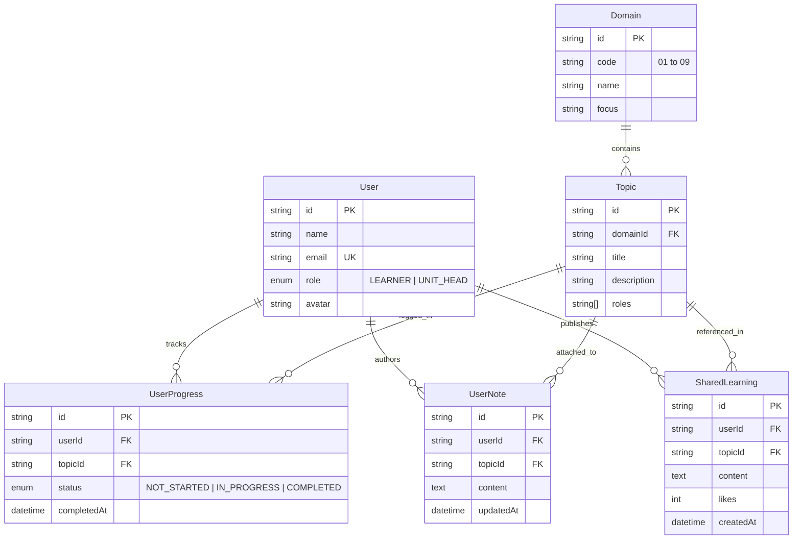

# Product Requirement Document (PRD) / Technical Specification
**Project:** TXL Learning & Competency Operating System (TLMS)  
**Author:** Senior Product Manager (AI & Product Pod)  
**Status:** Approved for Implementation  
**Target Release:** Q1 2026  
**Audience:** Pod Engineers, Tech Leads, Unit Heads, Service Designers  

---

## 1. Executive Summary & Vision

### 1.1 Context
Total Experience Lab (TXL) is transitioning from a traditional UI design shop into an AI-agent-assisted, spec-driven product organization. Chapter 15 of the *TXL Playbook 2026* defines a universal curriculum of **74 competencies across 9 operational domains** required to deliver client products with autonomous agents and structured markdown specifications.

### 1.2 Vision Statement
To build an interactive, data-driven competency portal that transforms static playbook guidelines into an active operational routine—enabling continuous skill progression, transparent competency tracking, cross-pod knowledge exchange, and executive oversight into organizational capability maturity.

---

## 2. Problem Statement & Objectives

### 2.1 The Problem
1. **Low Knowledge Retention:** Playbook guidelines and skills listed on static web pages remain passive reading material with zero accountability or habit loops.
2. **Blind Spots for Leadership:** Unit Heads lack real-time visibility into team strengths, role readiness, and skill gaps across squads and delivery pods.
3. **Siloed Insights:** Individual learners solve edge cases, test AI workflows, or discover architectural patterns in isolation without a centralized medium to share findings with their peers.

### 2.2 Objectives & Key Results (OKRs)

| Objective | Key Result (KR) |
| :--- | :--- |
| **Drive Curriculum Adoption** | 100% of TXL unit members onboarded with at least 5 baseline competencies completed within 30 days. |
| **Increase Skill Transparency** | Unit Heads achieve 100% real-time visibility into pod-level competency distribution and skill deficits. |
| **Foster Cross-Pod Learning** | Average of ≥ 2 shared takeaways/learnings published per active learner per month. |

---

## 3. User Personas & Target Roles

### Persona 1: The Learner (Product Engineer / AI PM / Service Designer)
* **Goal:** Understand what skills are expected for their tier (L1–L3), track completed topics, take implementation notes, and demonstrate capability to leads.
* **Pain Point:** Overwhelmed by lengthy documentation without a clear, personalized roadmap or proof of progress.

### Persona 2: The Unit Head / Pod Lead
* **Goal:** Monitor team velocity, identify aggregate skill gaps before staffing high-stakes client engagements, and mentor individual contributors.
* **Pain Point:** No aggregated reporting; relying on subjective check-ins and performance reviews to gauge technical readiness.

---

## 4. Jobs-To-Be-Done (JTBD)

* **JTBD 1 (Progress Tracking):** *When I* study a new competency from Chapter 15, *I want to* mark its status and record my project-specific notes, *so that I can* remember how I applied it and maintain a personal portfolio of verified skills.
* **JTBD 2 (Knowledge Sharing):** *When I* discover a practical tip or tool pattern, *I want to* share it with my delivery pod, *so that* my team avoids repeating common pitfalls.
* **JTBD 3 (Organizational Oversight):** *When I* staff an upcoming client build, *I want to* inspect individual and domain-wide proficiency metrics, *so that I can* allocate the right consultants and engineers with high confidence.

---

## 5. Functional Specifications

### 5.1 Role-Based Access Control (RBAC)
* **User Roles:**
  * `LEARNER`: Access to Curriculum, Personal Progress, Personal Notes, and Public Learning Feed.
  * `UNIT_HEAD`: Full `LEARNER` privileges + access to Executive Analytics, Organizational Matrix, and Individual Learner Inspection.
* **Session Management:** Secure cookie-based session with JWT / Auth.js standard.

### 5.2 Curriculum Engine ("What to Learn")
* **Domain Hierarchy:** Supports 9 core domains (`01 Business`, `02 Product`, `03 Service Design`, `04 AI`, `05 Development`, `06 Analytics`, `07 Growth`, `08 Security`, `09 Consulting`).
* **Topic Schema:** 
  * Title, Description, Domain Code, and Target Audience Tags (`Everyone`, `Consultant`, `Service Designer`, `AI PM`, `Engineer`).
* **Search & Filters:**
  * Sub-string search across topic title and description.
  * Role filter dropdown with default preset to the learner's primary discipline.

### 5.3 Interactive Progress & Note-Taking
* **Progress State Machine:**
  * `NOT_STARTED` (Default) ➔ `IN_PROGRESS` (Active study) ➔ `COMPLETED` (Verified).
  * Instant optimistic UI updates with persistence.
* **Contextual Markdown Notes:**
  * Every topic has an independent note record per user.
  * Supports rich text / Markdown formatting for code snippets, architecture sketches, and links.

### 5.4 Team Learning Feed (Social Proof & Sharing)
* **One-Click Share:** Prompts user upon topic completion or note save to broadcast a high-signal takeaway to the team.
* **Community Interactions:** Teammates can view, like, and cite shared notes in daily synchronizations.

### 5.5 Unit Head Command Center (Executive View)
* **Macro KPI Suite:**
  * Active Learner count across pods.
  * Team-wide completion rate percentage.
  * Highest Velocity Domain vs. Deficit Domains (requiring targeted workshops).
* **Micro Drill-Down Inspector:**
  * Filterable roster of team members.
  * Domain-by-domain progress visualizer (stacked bar / percentage meter).
  * Audit log of individual member notes and completed dates.

---

## 6. Technical Architecture & Data Model

### 6.1 Entity-Relationship Model (Prisma)



### 6.2 API Data Contracts

#### 1. Update Progress
* **Endpoint:** `PATCH /api/progress`
* **Access:** `LEARNER`, `UNIT_HEAD`
* **Request:**
  ```json
  {
    "topicId": "ai-3",
    "status": "COMPLETED"
  }
  ```
* **Response (200 OK):**
  ```json
  {
    "id": "prog-uuid",
    "userId": "user-1",
    "topicId": "ai-3",
    "status": "COMPLETED",
    "completedAt": "2026-10-22T08:30:00Z"
  }
  ```

#### 2. Upsert Note
* **Endpoint:** `POST /api/notes`
* **Request:**
  ```json
  {
    "topicId": "ai-3",
    "content": "Spec-driven testing enables zero-shot Playwright generation."
  }
  ```

#### 3. Organizational Analytics
* **Endpoint:** `GET /api/analytics`
* **Access:** `UNIT_HEAD` only (HTTP 403 Forbidden for `LEARNER`)
* **Response:** Returns aggregated stats and member rosters with domain progression maps.

---

## 7. Non-Functional Requirements (NFRs)

* **Performance:** First Contentful Paint (FCP) < 1.0s; Client-side search and filtering latency < 50ms.
* **Accessibility:** Full compliance with **WCAG 2.1 AA** (keyboard navigability, minimum 4.5:1 color contrast ratio, semantic ARIA attributes).
* **Security & Confidentiality:**
  * Notes and learnings strictly scoped to authenticated organization domain (`@selise.ch`).
  * Unit Head routes protected by server-side middleware authorization.
* **Design System:** Consistent with the TXL Playbook dark aesthetic (`#090d16` background, slate typography, vibrant blue/indigo accents).

---

## 8. Rollout Plan (Horizons Framework)

```
┌─────────────────────────────────────────────────────────────┐
│ NOW (Sprint 1-2): Core Delivery Engine                      │
│ - 9 Domains, 74 Topics seeded                               │
│ - Checkmarking & progress percentage tracking               │
│ - Local markdown note-taking                                │
│ - Unit Head prototype switcher                              │
└──────────────────────────────┬──────────────────────────────┘
                               │
┌──────────────────────────────▼──────────────────────────────┐
│ NEXT (Sprint 3-4): Engagement & Social Layer                │
│ - NextAuth SSO integration with Google / Azure AD           │
│ - Team Learning Feed with reactions & comments              │
│ - Playwright automated E2E test suite                       │
└──────────────────────────────┬──────────────────────────────┘
                               │
┌──────────────────────────────▼──────────────────────────────┐
│ LATER (Sprint 5+): Intelligent Guidance                     │
│ - AI-assisted learning recommender based on client project  │
│ - Slack / MS Teams webhook integration for shared learnings │
│ - Skill gap radar charts for staffing proposals (SOWs)      │
└─────────────────────────────────────────────────────────────┘
```
